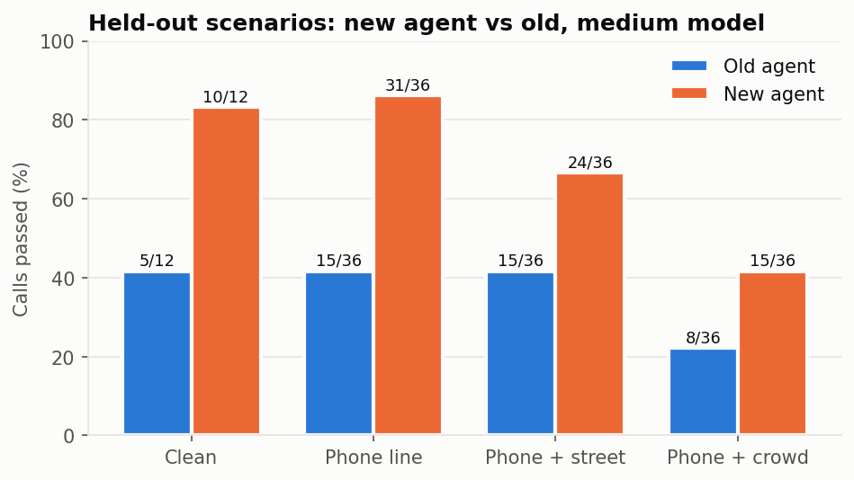
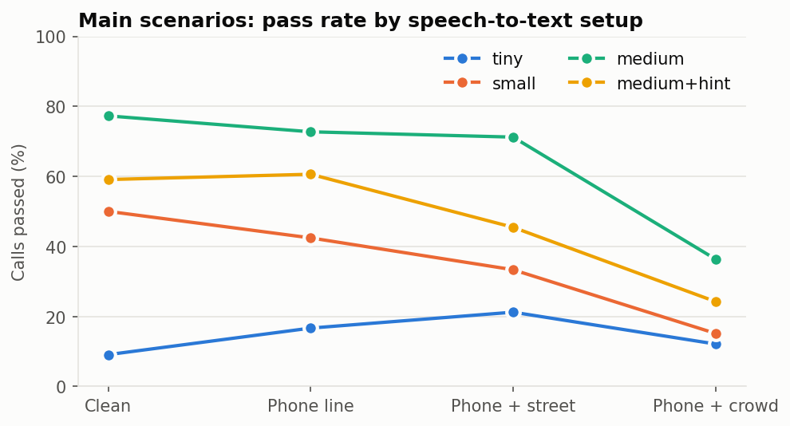
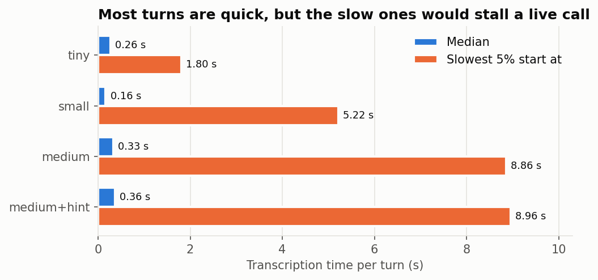

# Parakh

**Parakh** (परख, "to test the quality of something") stress-tests voice agents against difficult
Hinglish phone calls. It simulates callers, degrades their audio the way a phone line and background
noise would, sends it through speech-to-text into an agent, and scores whether the agent took the right
action.

The test agent confirms cash-on-delivery (COD) orders. A wrong action here has a real cost: shipping an
order the customer cancelled, or cancelling one they wanted.



## Key results

Measured on simulated calls. See [Limits](#limits) before quoting any of these.

- **Pass rate on held-out scenarios rose from 36% to 67%** (43 to 80 of 120 calls, `medium` model) after
  making the agent tolerate sound-alike spellings. These scenarios were written before the fix and never used to tune it.
- **No wrong actions in 1,220 calls** with the new agent. When it was unsure, it handed the call to a human.
- **`medium` was the most accurate setup tested** (62% on the main scenarios), against 32% for `small` and 16% for `tiny`.
- **Priming Whisper with a topic hint hurt:** 45% with it against 62% without, and its words sometimes
  appeared in transcripts for audio that never said them.
- **Speed is the main blocker for live use:** `medium` has a median of 0.33 s per turn, but the slowest 5%
  take 8.9 s or more.

| Setup | Clean | Phone | Phone + street | Phone + crowd | Overall | Median per turn | p95 per turn |
|---|---|---|---|---|---|---|---|
| `tiny` | 2/22 | 11/66 | 14/66 | 8/66 | 16% | 0.26 s | 1.8 s |
| `small` | 11/22 | 28/66 | 22/66 | 10/66 | 32% | 0.16 s | 5.2 s |
| `medium` | 17/22 | 48/66 | 47/66 | 24/66 | 62% | 0.33 s | 8.9 s |
| `medium+hint` | 13/22 | 40/66 | 30/66 | 16/66 | 45% | 0.36 s | 9.0 s |

Timing is for transcribing finished clips on an RTX 4060 Laptop GPU. It excludes the LLM, speech synthesis and network.




## How it works

```
scenario (YAML)  ->  caller line  ->  synthesised speech (edge-tts)
                                              |
                                  phone line + street or crowd noise
                                              |
                                  speech-to-text (faster-whisper)
                                              |
       agent  <-  transcript          caller reacts to the agent's next question
         |
   outcome and captured values  ->  score: pass / handoff / wrong action
```

| File | Purpose |
|---|---|
| `scenarios/cod_confirmation.yaml` | 22 main scenarios, including number formats, language switching and trick phrases such as "cancel मत करो" |
| `scenarios/cod_holdout.yaml` | 12 held-out scenarios. Never tune the agent on these |
| `parakh/audio.py` | Speech synthesis, 8 kHz phone-line simulation, street and crowd noise at a set signal-to-noise ratio |
| `parakh/stt.py` | Whisper transcription with timing |
| `parakh/normalize.py` | Reads digits, intents and days from messy Hinglish, in Devanagari or Latin script |
| `parakh/agent.py` | Rule-based COD agent; reads pincodes back and hands off when unsure |
| `parakh/run.py` | Runs every scenario across setups and conditions, and scores the calls |
| `parakh/report.py` | Tables and figures |
| `dashboard.py` | Results, plus failed calls with the audio and transcripts |

Each run also feeds the agent the caller's exact words. If a call passes that way but fails with audio, the
agent's logic is fine and the problem lies in the speech layer or in how the agent reads transcripts.

## What the evaluation caught

These are in the project because finding them is what the tool is for.

- **Over-strict word matching looked like bad speech recognition.** "दीजिये" was rejected because the agent expected "दीजिए".
- **A test flaw made a small model appear to improve with noise.** Retries replayed the identical clip on clean audio, while noise gave each retry a fresh chance.
- **A hint containing test vocabulary inflated scores.** It was replaced with a neutral sentence, which then performed worse than no hint.
- **Exact-word tests found real agent bugs,** such as treating "cancel मत करो" (don't cancel) as a cancellation.

Details are in [results/NOTES.md](results/NOTES.md) and [results/phase4/NOTES.md](results/phase4/NOTES.md).

## Setup

Requires Python 3.10 or newer. Generating caller audio needs internet access, and the first run downloads the Whisper models.

```powershell
python -m venv .venv
.venv\Scripts\activate
pip install -r requirements.txt
python -m pytest tests
```

### GPU setup

GPU runs need NVIDIA's cuBLAS library. On Windows, one way to get it is through a CUDA build of PyTorch
(about 2.6 GB). Then tell Parakh where its libraries are:

```powershell
pip install torch --index-url https://download.pytorch.org/whl/cu126
$env:PARAKH_CUDA_DLL_DIR = "$PWD\.venv\Lib\site-packages\torch\lib"
```

Without a GPU, add `--device cpu` to the run commands. It is much slower.

## Usage

```powershell
# Agent logic only: no audio, runs in seconds
python -m parakh.run --oracle-only --out results\check

# Full evaluation; about an hour on an RTX 4060 Laptop GPU
python -m parakh.run --models tiny small medium --out results\my_run

# Held-out scenarios
python -m parakh.run --scenarios scenarios\cod_holdout.yaml --models medium --out results\my_holdout

# Report figures from the saved results
python -m parakh.report

# Dashboard
streamlit run dashboard.py
```

Failed-call audio is not stored in git. Without it, the dashboard shows only transcripts until you re-run the
evaluation with `--out results\phase4` or `--out results\phase4_holdout`, which replaces those saved results.

## Testing another agent

An agent needs `start()`, `reply(transcript)` and a `result` holding its outcome and captured values; see
`parakh/agent.py`. To swap it in, change the agent created in `run_call` in `parakh/run.py`. Parakh has so far
tested only the included rule-based agent, and no LLM or hosted agent is connected yet.

## Limits

- **Simulated calls.** Voices are synthesised and noise is generated. There is no real phone audio, and regional accents are not tested.
- **A simple agent.** Results describe this rule-based agent and these Whisper setups, not voice agents in general.
- **A small scenario set.** There are 22 main and 12 held-out scenarios, all written by the same author. Calls from one scenario are not independent, so 120 calls is not 120 separate tests.
- **Interruptions are not tested,** because the pipeline has no barge-in.
- **Speed is partial.** It covers batch transcription only, not streaming or a full live call.
- **The failure labels are approximate.** `close_but_rejected` and `misheard` are split by spelling similarity.

## Next steps

1. Connect a real hosted or LLM agent.
2. Find out why some turns are slow, and test streaming transcription.
3. Test on real recorded calls, with consent.
4. Add interruptions and regional accents.
